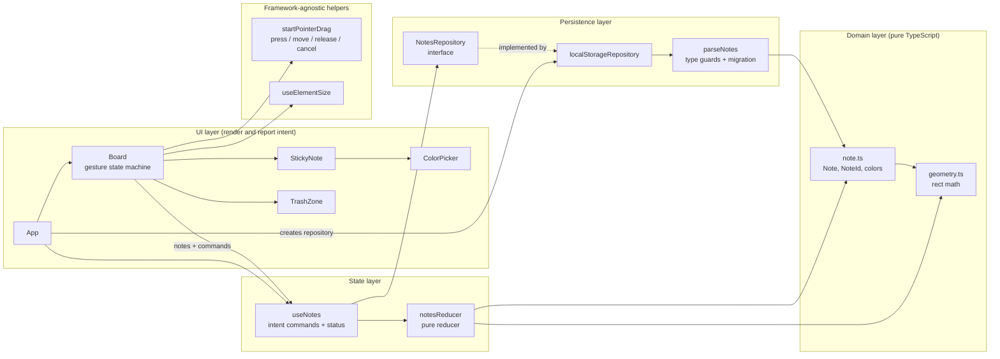

# Sticky Notes

Single-page sticky notes app. React 19 + TypeScript (strict) + Vite + vanilla CSS. No UI, drag-and-drop or state libraries.

## Run

Requires a current Node.js LTS.

    npm install
    npm run dev       # http://localhost:5173
    npm run build     # typecheck + production build into dist/
    npm run preview   # serve the production build
    npx vitest run    # unit tests
    npm run lint

## Features

Required: create a note by dragging on empty space (size and position = the rectangle you draw),
resize from the bottom-right corner, move by the header, delete by dropping on the trash.

Bonus: note text, bring to front on click, localStorage persistence, 5 colors.

Escape cancels any drag.

## Storage modes

- `/?storage=local` plain localStorage

## Architecture

Architecture description

The app has four layers:
1. The domain layer (domain/) is pure TypeScript: a Note type with a branded NoteId, and geometry function. 
2. The state layer (state/) is a pure reducer with a discriminated union of actions, wrapped by a useNotes hook that exposes intent commands instead of dispatch. 
3. The persistence layer (persistence/) is a NotesRepository interface with a localStorage implementation. 
4. Components only render and report user intent.

Arrows point from caller to callee: components depend on the state, domain and helper layers, and the state layer talks to persistence through the `NotesRepository` interface.

All drag interactions use Pointer Events with pointer capture rather than HTML5 drag-and-drop, which gives consistent behavior across Chrome, Firefox and Edge and supports resizing. A small framework-agnostic helper (startPointerDrag) handles the press-move-release-cancel lifecycle, including Escape, pointercancel and window blur. The Board owns a single gesture state machine (idle | creating | moving | resizing). During a gesture only a preview rectangle in the Board's local state changes; the store is updated once, on release. Combined with React.memo, stable command callbacks and a reducer that preserves the identity of untouched notes, only the dragged note re-renders on each pointer move. Positions use CSS transforms to avoid layout, and the board and trash are measured once per gesture instead of on every move.

Persistence is optimistic: the UI updates immediately and repository calls run in a serial queue (a small framework-free module with its own tests) so the server applies changes in the order the user made them. Network errors and 5xx responses are retried with backoff, and a status badge reports exactly whether everything is saved; closing the tab with unsaved changes asks for confirmation. Text edits update the UI on every keystroke but are saved once per typing pause, per note. If a request fails, the user sees an error and the board re-syncs from the server once no local change is still pending, which is simpler and safer than per-change rollback. All data from storage or the network is parsed from unknown with type guards (including a migration for notes saved before colors existed), so there are no unchecked casts at the trust boundary.